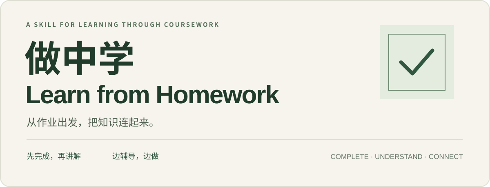

  
  

    
    
    
    
  

  
<strong>跨课程作业辅导 · 课件优先 · 两种学习节奏 · 多语言作答</strong>

  
<a href="#使用">快速开始</a> · <a href="#更多调用示例">调用示例</a> · <a href="#暂停与继续">暂停与继续</a>

# 做中学 · Learn from Homework

一个跨课程的作业／问题导向学习 skill，支持整份作业、单题和课堂问题。辅导语言与正式作答语言分别选择，支持中文、英文及其他所需语言。

A reusable skill for completing and understanding homework across subjects. Choose file-first completion or tutoring while solving, with separate languages for explanations and submitted answers.

它帮助你从作业中建立知识框架、理清逻辑、发现薄弱点，并练习迁移。适合需要先完成作业再理解的紧急情况，也适合希望边做边学的日常学习。

## 使用

这是供 AI 助手读取的技能指引，需要搭配支持技能的工具使用。文件读取、文档编辑与运行代码的能力取决于所用工具；本 skill 不提供独立应用或自动提交作业功能。

### 1. 安装

在 Codex 中调用 `$skill-installer`，提供本仓库链接，并请其安装仓库根目录中的 `learn-from-homework` skill。安装后若未出现，可重启 Codex。

可直接发送：“使用 $skill-installer，从 https://github.com/Siso0227/learn-from-homework 安装仓库根目录中的技能，名称为 learn-from-homework。”

也可以下载仓库，将包含 `SKILL.md` 的完整文件夹命名为 `learn-from-homework`，放入所用工具支持的技能目录。Codex 当前官方文档列出的用户级目录为 `~/.agents/skills/`；不同工具与版本请参照各自说明。参见 [Codex 技能说明](https://learn.chatgpt.com/docs/build-skills)。

### 2. 准备自己的资料

在私人课程文件夹放入作业原模板、相关课件，以及可用的评分标准或提交要求；让助手能读取该文件夹，或通过工具支持的方式提供附件。不需要把资料提交到本仓库，也不必先填写配置表。

没有可用资料时，助手会先提醒提供，或询问能否使用外部资料，不会直接替换为外部答案。

### 3. 发出请求

例如：“使用 $learn-from-homework 帮我完成当前文件夹中的作业。中文辅导、英文作答，先完成整份文件，再逐题讲解。”

### 4. 确认后开始

助手先读取本地已保存的适用偏好和作业要求，判断文体及逐题任务，再集中确认尚未明确的完成方式、辅导语言、作答语言与具体风格；必要时一并确认截止时间、缺少资料以及正式副本名称。已说清楚的内容不重复询问。正式副本名称经你确认后才创建，原模板保留。

短问答、实验报告与论述题会采用不同表达。风格不明确时先给具体建议，必要时用一个短答案校准后再应用到整份作业；已有样例或明确要求直接完成时不会额外强加等待。简洁意味着去掉绕弯表达，不是删掉必要理由、机制或计算步骤。

两种方式可以随时切换：

| 方式 | 使用流程 |
|---|---|
| 先完成文件，再讲解 | 阅读要求和课程依据 → 完成各题及必要推理 → 检查答案并交付副本 → 逐题讲解、诊断、补弱与练习 |
| 边辅导边做 | 建立最小知识框架 → 短诊断与分层推理 → 形成答案并检查 → 补弱与变式 → 逐步完成副本 |

### 5. 暂停或继续

需要暂停时可说“总结当前进度，方便下次继续”。助手会按需提供续接摘要；如需跨次保存，先经你同意，再放在私人课程目录中。下次提供摘要或允许读取记录即可续接。

## 讲题时如何追溯依据

先匹配并核对课程来源，再展开讲解；关键知识给出准确页码，PDF 页序与幻灯片编号不同时分别标注。公式、图示及相似例题优先配原页视觉证据，解释它与本题步骤的联系；重复来源不反复截图，无法显示时明确限制。相似例题须核对目标、条件和假设，不直接照搬。

讲解围绕必要的知识依赖定位薄弱点，并更新课程知识地图。未检验、提示下完成、独立应用与具体困难依据实际回应区分；助手完成了作业不代表用户已掌握。简单题只展示必要内容，不强制输出全部栏目。

## 作业后知识图谱

可选择生成“本作业知识＋必要前置”的图谱，或“已提供课程材料全景＋本作业高亮”的图谱。后者会说明资料覆盖范围，不默认每次梳理全课程。

覆盖范围、学习状态和依赖关系分别编码，配图例、题号及来源备注。支持按工具能力生成 XMind；不能可靠导出或预览时，会说明限制并提供层级大纲等替代选择，不冒充已验证的 XMind 文件。图谱与截图保存在私人学习材料中，不放入提交作业或公开包。

## 更多调用示例

示例请求：

- “用 $learn-from-homework 带我做这份作业。我基础薄弱，今晚提交，先保证核心逻辑和检查，再安排练习。”
- “用 $learn-from-homework 解释这道课堂问题，先看我的思路，给提示，暂时别展开完整答案。”
- “用 $learn-from-homework 检查这段程序的边界情况，再给一个能迁移解法的新题。”

流程为：要求 → 课程依据 → 最小框架与诊断 → 分层推理 → 答案及理解检查 → 补薄弱点 → 变式 → 知识地图。它是可调节的学习循环，不是每题必须逐项展示的输出模板。

开始时集中确认完成方式、辅导语言和作答语言，以及必要的资料、截止时间或文件命名缺项；已有明确要求不重复询问。完成方式可选“先完成整份作业文件，再逐题讲解”或“边辅导边做”。前者先完成答案验证与文件交付，诊断和练习放在后面；后者边学边形成答案。答案优先沿用课件的术语、定义与关键措辞，补充推理须与课件原话区分。助手应持续解释当前工作、依据与安排理由。

需要正式作业文件时，先读原模板和命名规范，报告要求并提出具体副本名，经用户确认才创建副本，保留原件。提交文件仅含清晰直接的答案及必要逻辑；辅导与检查记录留在对话或独立学习材料。

## 私人配置与分享

助手会根据明确反馈逐步适配解释长度、例子、提示方式和作业语言习惯，区分教学语言与提交语言。当前对话直接调整；经确认的长期偏好保存在用户安装目录内的 `private/`，每次调用先读取。跨课程通用、同类任务及本课程偏好分别保存，本次特殊要求不自动升级为通用规则。范围模糊时会先确认，用户可查看、修改、停用或删除。

因此同一台设备调用同一安装副本时，偏好可跨聊天、跨项目沿用；前提是工具能访问这些文件。不同安装副本和设备不自动同步。这是私人记录和流程调整，不是训练模型或自动修改公共 SKILL.md。首次使用无需创建任何文件，只有需要长期保存时才按确认范围生成。具体规则见 [偏好管理说明](references/preferences.md)。

没有可用课件时先提醒提供材料，或询问是否同意使用外部资料；同意前不以外部资料或一般知识替代课程答案。已经授权可读的课程资料无需重复上传。

`references/course-profile.example.md` 是虚构配置示例。复制到自己的课程目录后填写；实际课程资料和学习记录不要放进这个公开包。没有配置也能开始，提供题目与相关课件即可。

本仓库只包含通用指引与虚构配置示例，不包含真实课程文件、作业答案或个人学习记录，也不要求特定付费插件。实际使用须遵守课程对工具、引用和独立完成的要求。

## 许可证

本项目采用 [MIT 许可证](LICENSE)。Copyright © 2026 Siso0227。允许按许可证条件使用、修改、分发和商业使用；分发副本或实质性部分时须保留版权与许可声明。

本许可覆盖仓库内有权授权的项目内容，不自动覆盖用户提供的课件、第三方资料或私人学习记录。Agent Skills 徽章表示采用该格式，不代表官方认证。

### 更新和分享

更新或重装前，先在自己控制的私人位置备份安装目录内的 `private/`，只更新通用文件，更新后确认偏好仍在。GitHub 更新不会自动更新本地安装。分享、打包或网页上传时显式排除 `private/` 及真实课程资料；`.gitignore` 不会自动阻止 ZIP 或网页上传携带这些文件。

## 文件构成

| 文件 | 用途 |
|---|---|
| `SKILL.md` | 核心工作流程与行为规则 |
| `agents/openai.yaml` | 显示名称与默认调用提示 |
| `references/course-profile.example.md` | 可选的私人配置和进度记录示例 |
| `references/answer-style.md` | 按作业文体作答与短样例校准规则 |
| `references/preferences.md` | 私人偏好的确认、保存、读取与更新保护 |
| `references/course-evidence.md` | 课件定位、页码、截图与例题映射 |
| `references/knowledge-map.md` | 知识依赖、证据状态与可选图谱导出 |
| `README.md` | 安装与使用说明 |
| `LICENSE` | MIT 许可证全文 |
| `assets/banner.svg` | README 中英双语标题横幅 |

## 暂停与继续

暂停或阶段结束时，按需提供简短续接摘要，记录进度、答案状态、薄弱点与下一步。默认留在对话，经过同意可保存在私人课程目录；不进入提交文件。用户可直接使用本 skill，无需参与开发测试或调试流程。
